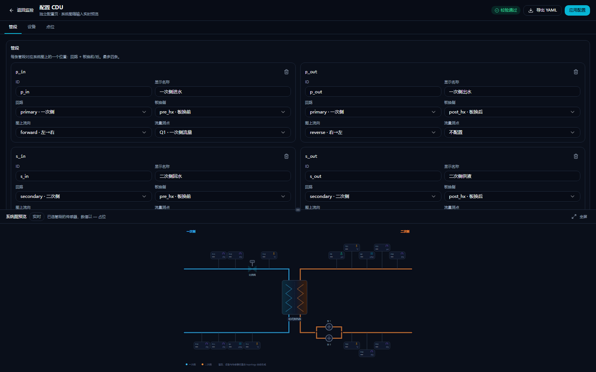
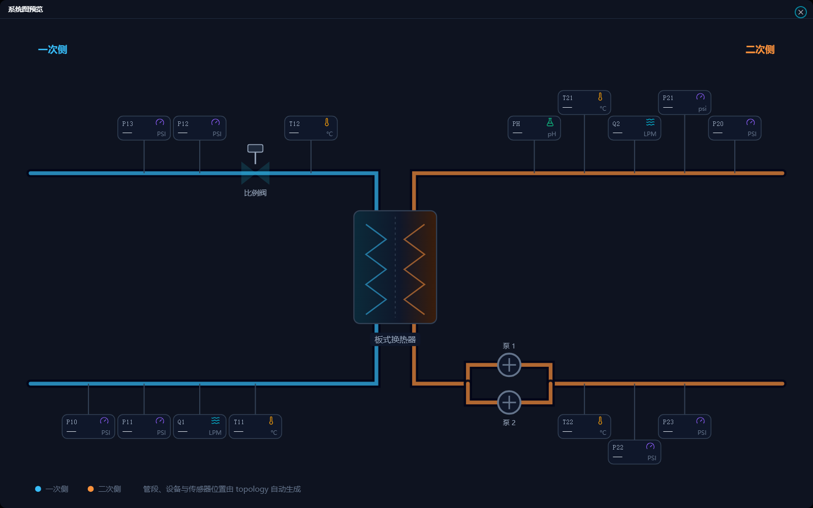

# cdu-sim

CDU（冷量分配单元）模拟器：没有实机时，给 CDU 控制程序提供一套可连接的 Modbus TCP 从站和会变化的过程量。

- **Modbus TCP**：写入阀门/水泵命令，读取传感器原始信号。
- **水力与热工**：阀开度 → 一次侧流量，泵速 → 二次侧流量/压力，板换换热 → 供液温度。
- **Web 监控**：P&ID、趋势、控制滑杆、点位表、点位在线编辑。
- **配置驱动**：点位和设备拓扑都在 `config/tags.yaml`，换机型主要改配置。


## 快速使用

```powershell
cargo build --release
.\target\release\cdu-sim.exe
```

| 服务 | 默认地址 |
|---|---|
| Modbus TCP | `0.0.0.0:1502` |
| Web 监控 | <http://127.0.0.1:8080> |

配置在 `config/tags.yaml`；网页上的修改保存到 `config/overrides.yaml`，叠加在原始配置之上。页面从 `web/dist` 读取，请在仓库根目录启动；前端改动后先执行 `pnpm --dir web build`。

前端开发模式：`pnpm --dir web dev`，默认 <http://localhost:5273/>（5173 被 Windows 保留端口段占用），`/api` 和 `/ws` 代理到 8080，需要同时运行 `cdu-sim`。

常用参数：

| 参数 | 说明 |
|---|---|
| `-c, --config <file>` | 点表文件，默认 `config/tags.yaml` |
| `--bind <addr>` / `--http <addr>` | Modbus / Web 监听地址 |
| `--dump-points` | 打印拓扑和点表后退出，用于核对配置 |
| `--no-noise` | 关闭传感器噪声（测试用） |
| `--cold` | 忽略上电初始命令（测试用） |
| `--valve-stroke <s>` | 覆盖比例阀行程时间 |

页面上的操作：

- 顶部滑杆控制比例阀开度和水泵启停/转速，写入的是 `topology.equipment` 里配置的命令点。
- P&ID 点击传感器可看趋势；点位表可查看所有点，铅笔按钮可改地址、量程、信号类型。
- 右上角齿轮打开配置页，可编辑管段、设备和全部点位；校验不通过不能提交。
- 右上角切换深色/浅色主题和工程值/原始信号。

## 配置 CDU 拓扑

拓扑写在 `config/tags.yaml` 的 `topology` 段（YAML；`GET /api/topology` 返回同结构的 JSON）。它描述三件事：

- `segments`：有几条管段、属于一次侧还是二次侧、在板换前还是后、往哪个方向流。
- `equipment`：板换、比例阀、水泵分别装在哪条管段、对应哪些点位。
- `tags[].place`：每个传感器挂在哪条管段、管段内的什么位置。

### 管段 segments

| 字段 | 必填 | 说明 |
|---|---|---|
| `id` | 是 | 管段 id，设备/传感器用它引用 |
| `loop` | 是 | `primary` / `secondary` |
| `branch` | 是 | `pre_hx`（板换前）/ `post_hx`（板换后） |
| `label` | 否 | 页面显示名称 |
| `direction` | 否 | `forward`（左→右）/ `reverse`（右→左）；省略时按回路推导 |
| `flow` | 否 | 流量测点 id，用于流动动画；同回路其它管段会复用它 |

每个回路每个板换侧只能有一条管段，因此最多 4 条。

### 设备 equipment

| `type` | 必填字段 | 说明 |
|---|---|---|
| `heat_exchanger` | `id` | 板换，固定画在中间，不挂管段 |
| `valve` | `id`、`segment`、`order`、`cmd`、`pos` | 比例阀；`cmd`=开度指令，`pos`=开度反馈 |
| `pump` | `id`、`segment`、`order`、`run_cmd`、`run`、`speed_cmd` | 水泵；`fault` 可选 |

- `order` 是管段内的位置，沿流向递增；传感器和设备的 `order` 共用同一条坐标轴。
- 同一管段上 `order` 相同的多台泵按并联绘制，例如两台泵都写 `order: 5`。
- 设备引用的点位必须在 `tags` 中存在，且方向正确（如阀 `cmd` 必须是可写的 AO，泵 `run` 必须是 DI）。
- 当前模型支持 1 台板换、至多 1 个比例阀、1–2 台泵。

### 传感器位置

传感器本身仍在 `tags` 里定义，用 `place` 挂到管段：

```yaml
- id: T22
  desc: 二次侧供液温度
  kind: ai
  unit: "°C"
  range: [0, 80]
  place: { segment: s_out, order: 10 }
  modbus: { fc: 3, addr: 111 }
```

- `segment` 是 `segments[].id`。
- `order` 沿流向递增，越小越靠近上游。
- 同一管段上传感器太密时会自动交错成多排。
- 没有 `place` 的点（液位、命令点等）只出现在点位表，不进系统图。
- 旧写法 `place: { loop, branch, order }` 仍然兼容。

### 完整示例

```yaml
topology:
  segments:
    - { id: p_in,  loop: primary,   branch: pre_hx,  label: 一次侧进水, flow: Q1 }
    - { id: p_out, loop: primary,   branch: post_hx, label: 一次侧出水 }
    - { id: s_in,  loop: secondary, branch: pre_hx,  label: 二次侧回水, flow: Q2 }
    - { id: s_out, loop: secondary, branch: post_hx, label: 二次侧供液 }

  equipment:
    - { id: HX1, type: heat_exchanger, label: 板式换热器 }
    - { id: V1, type: valve, segment: p_out, order: 15,
        cmd: VALVE_CMD, pos: VALVE_POS }
    - { id: P1, type: pump, segment: s_out, order: 5,
        run_cmd: PUMP1_RUN_CMD, run: PUMP1_RUN,
        speed_cmd: PUMP1_SPEED_CMD, fault: PUMP1_FAULT }
```

接口返回的 JSON 就是 `{ "segments": [...], "equipment": [...] }`。

改完执行 `cargo run -- --dump-points` 可检查拓扑和点位映射。配置不合法会拒绝启动，并指出具体管段、设备或点位。

没有 `topology` 的旧点表也能打开页面：前端会按 `place.loop` / `place.branch` 合成四条管段，只画板换和传感器，阀门/泵控制提示未配置。

### 在网页上配置

右上角齿轮打开**独立配置页**（`#/config`），顶部可以返回监控。配置页分「管段 / 设备 / 点位」三个标签：



- **管段**：默认给出 4 段标准管段（一次/二次 × 板换前/后），也可以「插入默认 4 段」或手动新增/删除。
- **设备**：添加板换、比例阀、水泵，选择安装管段、`order` 和命令/反馈点。
- **点位**：新增/删除点位，编辑类型、单位、量程、信号类型、Modbus 地址、系统图位置和上电初始值。

页面底部固定显示**系统图实时预览**：改管段、设备、传感器位置时会立即重画；新传感器把必填信息（id、描述、单位、量程、地址、管段）填完整后就会出现在图上，数值以 `—` 占位。预览只用于确认布局，不读取运行值。

配置区和预览之间是可拖动的 **Resizable** 分隔条，可以按需要调整比例；预览右上角「全屏」可放大检查。所有表单控件使用 shadcn 的 Input / Select / Checkbox / Label。



所有字段实时校验：id 唯一且不含空白、量程上限大于下限、同一地址区不能重叠、设备引用的点方向/可写性必须正确、流量点必须放在对应管段上。存在错误时「导出 YAML」「应用配置」都不可用，服务端还会再校验一次。

- **应用配置**：写入 `config/overrides.yaml` 并立即热更新运行中的点表和拓扑，原始 `config/tags.yaml` 不变。
- **导出 YAML**：下载当前草稿对应的完整 `tags.yaml`，可以单独保存或交给别人启动。

删除 `overrides.yaml` 后重启即可恢复原始配置。

## 点表与信号

`config/tags.yaml` 的 `tags` 是全部 I/O 点，每个点包含 `id`、`kind`（AI/AO/DI/DO）、`unit`、`range`、`modbus: { fc, addr }`；模拟量还包含信号类型与量程。

寄存器里是**原始信号**，不是工程值，换算由控制程序完成。默认 4–20 mA，寄存器单位 µA：

```
raw = 4000 + (eng - range_lo) / (range_hi - range_lo) * 16000
```

例如 `T22` 量程 0–80 °C、工程值 32.7 °C → `raw = 10540`。每个点的量程、单位、信号类型（4–20 mA / 0–10 V / ADC / PT100）可独立配置。

页面上修改点位会写入 `config/overrides.yaml`，叠加在 `tags.yaml` 之上；删掉该文件即可恢复默认。

## 模拟行为

- 上电初始命令由点表的 `initial:` 决定：比例阀 100%，两台泵已启动但转速 0%。
- 阀门 0→100% 默认 90 s，可在 `plant.valve_stroke_s` 或 `--valve-stroke` 调整。
- `Q1 = 0.4 × 阀开度`；`Q2 = 0.25 × 运行泵转速之和`；`P22 = P21 + k·Q2²`。
- 逆流 ε-NTU 板换 + 二次回路热容；可在页面上设定一次侧进水温度、二次侧回水温度和 UA。
- 传感器默认带小幅一阶相关噪声，`--no-noise` 可关闭。

## 测试

```powershell
.\tests\smoke.ps1    # Modbus 冒烟
.\tests\thermal.ps1  # 热响应
.\tests\energy.ps1   # 能量守恒
```

## 已知限制

- 故障注入、场景脚本、时间加速未实现。
- `Plant` 模型仍按 `VALVE_CMD`、`PUMP1/2_*`、`Q1/Q2` 等固定位号读写；这些位号不变时，前端可自由调整设备和测点。
- 支持液-液 CDU 的标准四管段结构；多板换、串并联复杂网络不在范围内。
- 未实现 FC2/FC4 点位和多 unit id。

更多设计说明见 [`docs/系统分析与实施方案.md`](docs/系统分析与实施方案.md)。
