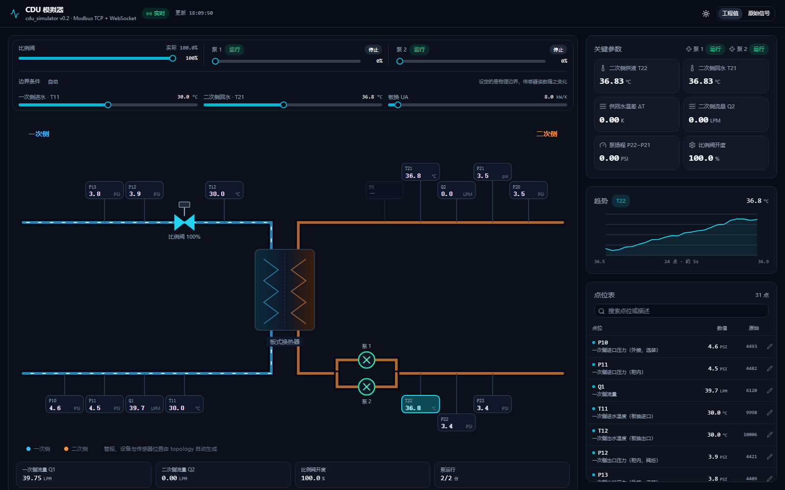
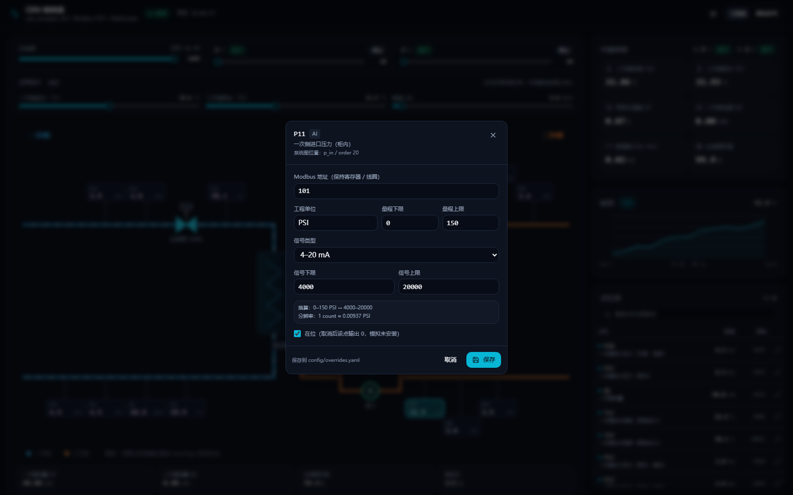

# cdu-sim

CDU（冷量分配单元）模拟器：没有实机时，给控制程序提供一个**可连接的 Modbus TCP 从站**，并附带一个**实时 Web 监控页**。

当前是 M0 + 基础热模型 + 拓扑驱动的系统图：接口、执行器动态、水力与集总热工、Web 监控、点位在线编辑、按 `topology` 渲染 P&ID 都可用；故障注入、场景脚本还没有。



## 快速开始

```powershell
cargo build --release
.\target\release\cdu-sim.exe
```

- Modbus TCP：`0.0.0.0:1502`
- Web 监控：<http://127.0.0.1:8080>
- 点表：`config/tags.yaml`

> 静态页面从 `web/dist` 读取，请在仓库根目录启动。前端改动后先 `pnpm --dir web build`。

参数：

| 参数 | 默认值 | 说明 |
|---|---|---|
| `-c, --config` | `config/tags.yaml` | 点表文件 |
| `--bind` | `0.0.0.0:1502` | Modbus 监听地址 |
| `--http` | `0.0.0.0:8080` | Web 监听地址 |
| `--unit` | `1` | 日志里显示的 unit id；实际接受任意 unit id |
| `--dump-points` | | 打印拓扑、点表、地址与信号量程后退出 |
| `--no-noise` | | 关闭传感器噪声（测试用） |
| `--no-overrides` | | 忽略 `config/overrides.yaml`（测试用） |
| `--cold` | | 忽略点表里的上电初始命令，从全零开始（测试用） |
| `--valve-stroke` | | 覆盖比例阀 0→100% 行程时间（秒） |

## 原始信号，不是工程值

寄存器里放的是**传感器原始信号**，工程换算由控制程序完成。默认 4–20 mA，寄存器单位 µA：

```
raw = 4000 + (eng - range_lo) / (range_hi - range_lo) * 16000
eng = range_lo + (raw - 4000) / 16000 * (range_hi - range_lo)
```

例如 `T22` 量程 0–80 °C，工程值 32.7 °C → `raw = 4000 + 32.7/80*16000 = 10540`。

每个点的工程量程、单位和信号类型都可以不同，互不影响：

| 点 | 单位 | 工程量程 | 信号类型 | 信号量程 | 工程值 → raw |
|---|---|---|---|---|---|
| `P11` | PSI | 0–150 | 4–20 mA | 4000–20000 µA | 65.3 PSI → 10962 |
| `P22` | PSI | 0–180 | 4–20 mA | 4000–20000 µA | 65.3 PSI → 9804 |
| `T22` | °C | 0–100 | PT100 (rtd) | 0–1000（0.1 °C/LSB） | 32.7 °C → 327 |
| `Q2` | L/min | 0–600 | 0–10 V | 0–10000 mV | 300 L/min → 5000 |

单位在压力（bar / kPa / MPa / PSI）、温度（°C / °F / K）、流量（m³/h / L/min / L/s / GPM）之间会自动换算：模型内部仍按 `tags.yaml` 的原始单位计算，显示与寄存器按当前配置的单位编码。

改信号类型可以只动一个点：

```yaml
signal:
  kind: current        # current | voltage | adc
  range: [4000, 20000] # µA；电压用 mV，ADC 用码值
```

单个点可以覆盖：

```yaml
- id: LEVEL
  signal: { kind: adc, range: [0, 4095] }
```

写指令（阀开度、泵转速）也按同一套信号量程解码，所以控制程序写 12000 就是 50%。

### 在页面上改点位

点位表每行右侧有铅笔按钮，可改：

- Modbus 地址（保持寄存器 / 线圈）
- 工程单位与工程量程（如 0–150 PSI、0–180 PSI、0–600 L/min）
- 信号类型：4–20 mA / 0–10 V / ADC 码值 / PT100（0.1 °C）
- 信号量程（切换类型时自动带出默认值，PT100 按量程 ×10）
- 在位状态（取消后该点输出 0，模拟未安装）

弹窗里会实时显示换算关系和分辨率（例如 `1 count ≈ 0.00937 PSI`）。



保存走 `PUT /api/tags/{id}`，后端先校验地址冲突与量程，再写入 `config/overrides.yaml`，重启后自动叠加到 `tags.yaml` 上。`tags.yaml` 本身不会被改动；想恢复默认，删掉 `config/overrides.yaml` 即可。

### 系统图由拓扑驱动

`config/tags.yaml` 里的 `topology` 描述管段和装在管段上的设备，传感器则挂在管段的某个位置：

```yaml
topology:
  segments:
    - { id: p_in,  loop: primary,   branch: pre_hx,  label: 一次侧进水, flow: Q1 }
    - { id: p_out, loop: primary,   branch: post_hx, label: 一次侧出水 }
    - { id: s_in,  loop: secondary, branch: pre_hx,  label: 二次侧回水, flow: Q2 }
    - { id: s_out, loop: secondary, branch: post_hx, label: 二次侧供液 }

  equipment:
    - { id: HX1, type: heat_exchanger, label: 板式换热器 }
    - { id: V1, type: valve, segment: p_out, order: 15,
        cmd: VALVE_CMD, pos: VALVE_POS }
    - { id: P1, type: pump, segment: s_out, order: 5,
        run_cmd: PUMP1_RUN_CMD, run: PUMP1_RUN,
        speed_cmd: PUMP1_SPEED_CMD, fault: PUMP1_FAULT }
```

- `segments`：管段 id、所属回路、板换前/后、图上流向。`direction` 省略时按「一次侧进 / 二次侧供液朝板换」推导。
- `flow`：该管段的流量测点；同一回路的其他管段复用它做流动动画。写 `Q1`/`Q2` 只是示例，换位号不用改前端。
- `equipment`：`heat_exchanger` / `valve` / `pump`，用 `segment` + `order` 定位；同一管段上 `order` 相同的多台泵按并联绘制。设备标签、命令点、反馈点都来自配置。
- 传感器位置：`place: { segment: s_in, order: 40 }`。旧写法 `place: { loop, branch, order }` 仍然兼容。

前端按 `segments` 画管段，按 `direction` 决定流向；传感器和设备共用 `order` 坐标轴沿流向排布，间距不够时自动交错成 1–3 排。**新增传感器只改 `tags.yaml`，换阀/泵/板换只改 `equipment`，前端不用动**。没有 `place` 的点（液位、命令点等）只出现在点位表里，不进系统图。

`--dump-points` 先打印拓扑（管段、设备、设备引用的点位），再打印点表；`GET /api/topology` 返回同一份拓扑的 JSON。加载时会校验：管段/设备 id 唯一、每个回路每个板换侧只有一条管段、恰好 1 台板换、至多 1 个比例阀、1–2 台泵（模型当前上限，阶段 3 扩展），设备引用的点位存在且 AI/AO/DI/DO 方向与可写性正确，传感器 `place.segment` 存在且与管段定义一致。

没有 `topology` 的旧点表也能打开页面：前端会按 `place.loop` / `place.branch` 合成四条管段，只画板换和传感器，阀门/泵控制会提示未配置。

系统图只画管段、传感器、板换、比例阀和泵；水箱、过滤器、单向阀、安全阀这些非传感器部件不画，它们的点位（如 `LEVEL`、`SAFETY_VALVE_OPEN`）仍在点位表里可查。

## Modbus 映射

| 区域 | 功能码 | 范围 | 说明 |
|---|---|---|---|
| 保持寄存器 | 03 读 / 06、16 写 | 100–202 | 模拟量（原始信号）+ 执行器指令 |
| 线圈 | 01 读 / 05、15 写 | 0–18 | 状态反馈 + 启停命令 |

- 每个模拟量占 1 个寄存器（u16）。
- 写只读点返回异常码 `0x02`；未定义地址读出 0。
- 选装点（P10/P13/P20/P23/pH）在 `present: false` 时输出 0（0 表示未安装/断线）。

点位明细见 [`config/tags.yaml`](config/tags.yaml)，`--dump-points` 可直接核对。

## 模拟行为

- **上电初始状态**：由点表的 `initial:` 决定，当前是比例阀 100%、两台泵运行在 0%（泵已启动但没转速）。`--cold` 可忽略初始命令，从全零开始。
- **比例阀**：0→100% 默认 90 s 行程，可在 `plant.valve_stroke_s` 或 `--valve-stroke` 调整；`VALVE_POS` 反馈实际开度。
- **双泵**：独立启停（启动 1.5 s、停止 1.0 s 延时）与独立调速；运行/故障反馈分开。轮换逻辑由控制程序决定，模拟器只执行命令。
- **水力**：`Q1 = 0.4 × 阀开度`；`Q2 = 0.25 × 运行中水泵转速之和`（停泵或转速为 0 时都是 0），`P22 = P21 + k·Q2²`。
- **热工**：逆流 ε-NTU 板换 + 二次回路热容积分；`T22` 随阀开度、泵速、负载变化。
- **纯水假设**：过滤器不建模，`P10 = P11`、`P13 = P12`、`P23 = P22`。

### 传感器噪声

默认给模拟量读数叠加小幅噪声：量程的 0.05%、时间常数 2 s 的一阶相关随机扰动——不是逐点白噪声，看起来更像真实变送器。噪声只影响读数和寄存器，不影响模型内部状态；控制程序读到的原始信号也会跟着抖。

```yaml
noise:
  enabled: true
  seed: 42          # 固定种子，便于复现
  sigma_pct: 0.05   # 量程百分比
  tau_s: 2.0        # 相关性时间常数
```

单点可以覆盖幅值（工程量单位）：

```yaml
- id: Q2
  noise_sigma: 0.15   # m3/h
```

需要确定性数据时加 `--no-noise`，冒烟与热响应测试就是这么跑的。

热工参数在 `config/tags.yaml` 的 `plant:` 段：

```yaml
plant:
  load_kw: 30                 # 机柜负载
  ua_kw_per_k: 8              # 板换 UA
  loop_capacity_kj_per_k: 400 # 二次回路热容
  facility_supply_c: 30       # 一次侧供水温度
  valve_stroke_s: 90          # 比例阀 0→100% 行程时间
```

## Web 监控

- WebSocket `/ws` 以 5 Hz 推送整帧快照，HTTP `/api/points` 返回同一份 JSON。
- 深色 / 浅色主题切换（右上角太阳/月亮），选择存在 `localStorage`，刷新不闪。
- WebSocket 断开时全屏遮罩提示，1.5 s 自动重连，也可以点「立即重试」。
- 管路流动动画由 `requestAnimationFrame` 直接驱动 `stroke-dashoffset`，与数据刷新解耦，流量变化时也不会重置动画。
- P&ID 上点击传感器可看趋势；右上角切换「工程值 / 原始信号」。
- 系统图顶部是手动控制栏：比例阀开度、水泵启停与转速，全部用 shadcn Slider。写入的是 `topology.equipment` 里该设备配置的 `cmd` / `run_cmd` / `speed_cmd` 点，和 Modbus 主站共用同一组命令点。
- 控制栏还可以设边界温度（一次侧进水、二次侧回水）和板换 `UA`。滑杆设定的是**物理边界**，传感器读数随之变化；显示位号通过 `place` 找该管段上最靠近板换的温度测点，不写死 `T11`/`T21`，改点位名后标签自动跟随。
- 设定回水温度后按板换换热量直接解出供液温度，`C1·(T12−T11) = C2·(T21−T22)` 瞬时成立；提高 `UA` 会让 `T12` 升高、`T22` 降低。点「自动」恢复配置值。
- 改泵速会立刻反映到 `Q2` 和 `P22`：两泵流量叠加、供液压力随流量平方上升。
- HTTP 写命令：`PUT /api/points/{id}`，模拟量用 `{"value": 60}`，开关量用 `{"on": true}`；边界温度与 UA 用 `PUT /api/plant`，`DELETE /api/plant` 恢复自动。
- 前端：React + Vite + Tailwind + shadcn 组件 + lucide-react，构建产物由 Rust 直接托管。

开发模式（Vite 代理到 8080）：

```powershell
pnpm --dir web dev      # http://127.0.0.1:5173
```

截图（驱动本机 Edge）：

```powershell
node web/scripts/shot.mjs http://127.0.0.1:8080/ docs/ui.png
```

## 测试

```powershell
.\tests\smoke.ps1    # 接口冒烟：原始信号、读写、行程、泵启停、异常码，约 8 s
.\tests\thermal.ps1  # 热响应：关小阀门后 T22 上升，约 80 s
.\tests\energy.ps1   # 能量守恒：强制 T21 后检查两侧热量，约 8 s
```

脚本会自动带 `--no-noise --no-overrides --valve-stroke 2` 启动测试实例（端口 15021/15022/15023），跑完自动关闭。

## 目录

```
config/tags.yaml      点表（唯一真相源）
config/overrides.yaml 页面修改后的覆盖（自动生成，可删）
src/tags.rs           点表 + 拓扑加载、校验、工程值 ↔ 原始信号换算
src/state.rs          当前值 + 寄存器读写 + 快照 + 点位编辑
src/plant.rs          水力 / 热工模型
src/modbus.rs         Modbus TCP 从站（FC1/3/5/6/15/16）
src/http.rs           HTTP + WebSocket + 静态页面 + PUT /api/tags/{id}
src/main.rs           CLI、引擎线程
web/                  React 监控页（系统图与指标按 topology 派生）
tests/                冒烟与热响应测试
docs/                 系统分析、实施方案、界面截图
```

## 已知限制（下一步）

- 没有故障注入（断线、卡死、漂移、泵故障、单向阀卡开）。
- 没有场景脚本与时间加速。
- 水箱液位恒为 60%，未做质量平衡；安全阀只置位，不泄放。
- 页面可以写命令点（阀门、泵），但传感器过程值仍由模型产生，不能强制覆盖。
- `place` 目前只能在 `tags.yaml` 里改，页面上不提供编辑。
- 系统图按「一次侧 / 二次侧 × 板换前 / 后」四个标准位置排版；更复杂的管路网络（多板换、串并联支路）不在当前模型范围内。
- `Plant` 模型仍按 `VALVE_CMD`、`PUMP1/2_*`、`Q1/Q2`、`T11/T21` 等固定位号读写（阶段 3 改为按 topology 映射）；在这些位号保持不变时，前端可以自由调整设备与测点。
- 未做多 unit id、FC2/FC4 点位。
